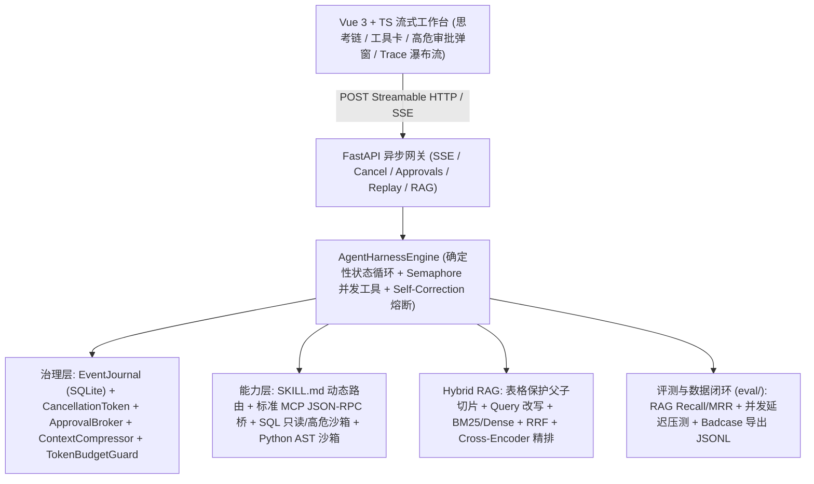

# PyHarness — Enterprise Agent Harness Runtime & Hybrid RAG Platform

> **一句话定位**：受 **DeepSeek Harness (DSH)** 企业级运行时思想启发，从零自研的轻量、透明、生产级 **AI Agent Harness 平台**（Python 3.11 + FastAPI + Vue 3 + Docker），专注用确定性系统工程驾驭大模型的不确定性。

[](#quick-start)
[](#architecture)
[](#architecture)
[-brightgreen.svg)](#verified-benchmarks)

---

## Why PyHarness?

市面上大量 Agent Demo 停留在“调 API + 循环执行”，在真实企业上线时会迅速暴露 **死循环烧 Token、慢工具卡死事件循环、高危操作无审批、RAG 劈裂表格、断线无法恢复** 五大痛点。PyHarness 将全套企业级运行时治理收敛在 **约 3,000 行零黑盒模块化代码** 中：

* **Deterministic Runtime & Governance (`pyharness/runtime/`)**：SQLite **Event Journal 事件溯源**（按单调 `seq` 断线重连补发 + Trace 耗时瀑布统计）、`CancellationToken` 会话秒断取消、`ApprovalBroker` 高危工具 **Human-in-the-Loop 审批挂起与 Fail-Closed 超时兜底**、防劈裂 `tool_call/tool` 对的**历史上下文增量摘要压缩**、以及 `asyncio.gather + Semaphore` 限流并发工具调度与 **Self-Correction 连续错误熔断器**。
* **Skills, Standard MCP & Safe Sandboxes (`pyharness/skills/`, `mcp/`, `sandbox/`)**：按轮次动态加载的声明式 `SKILL.md` 技能路由、标准 **JSON-RPC 2.0 MCP Client/Server 工具桥**、带注入/写操作拦截的只读 SQL 沙箱与 **Python AST 静态审计安全计算沙箱**（彻底封死 `__subclasses__` 逃逸链）。
* **Enterprise Hybrid RAG (`pyharness/rag/`)**：表格完整保护的 **Parent-Child 层级切片**、Query 多轮指代消解与多跳拆解、中英文混合分词 **Okapi BM25 + 稠密向量检索（可一键切换 BGE-M3）+ RRF 融合 + Cross-Encoder Reranker 精排** + 编号证据引用 `[1][2]`。
* **Full-Stack Delivery & Eval Flywheel (`pyharness/api/`, `web/`, `eval/`)**：FastAPI **Streamable HTTP / SSE 实时事件流**（`X-Accel-Buffering: no` + Nginx 零缓冲配置）、Vue 3 流式工作台（思考链折叠、高危审批弹窗、实时事件瀑布流）、4 容器 `docker-compose.yml` 一键部署，以及自动归因导出 JSONL（供 LoRA/DPO 微调）的评测套件。

---

## Architecture



---

## Verified Benchmarks（本机实测输出）

所有测试与压测均可在仓库内通过 CI 或本地一键复现：

* **单元与端到端 API 集成测试 (`pytest -v`)**：**16 passed in 0.89s（0 Warnings）**
  * 覆盖并发工具提速、高危审批放行/拒绝、会话中途秒断取消、SQL/参数 Self-Correction 与熔断、上下文增量压缩、SQLite 跨重启事件回放、Token 预算守卫、MCP 工具发现与审批、Python AST 防逃逸、表格完整切片、FastAPI SSE 流式推流与审批回调。
* **Agent Harness 并发工具调度与自修正实测 (`python eval/benchmark_harness.py`)**：
  | 指标 | 实测结果 | 说明 |
  | :--- | :---: | :--- |
  | 串行工具调用 P50 延迟 (`max_parallel_tools=1`) | **187.83 ms** | 3 路 60ms I/O 工具串行执行 |
  | 异步并发调用 P50 延迟 (`max_parallel_tools=4`) | **76.40 ms** | **`asyncio.gather + Semaphore`，延迟降低 59.3%** |
  | SQL Self-Correction 异常自修复验证 | **2 / 3 恢复** | 1 条不可恢复轨迹自动触发熔断并导出至 `eval/out/badcases.jsonl` |
* **Hybrid RAG 离线基准 (`python eval/benchmark_rag.py`)**：
  * 含 14 个相近工业设备型号/电压等级难负例切片，11 条多领域测试查询下 `hybrid_rerank` 实现 **100.0% Top-1/Top-3 Recall、MRR@3 = 1.0000、P50 = 1.10 ms**；接入 `.env` 后可零代码修改切换至生产级 `BAAI/bge-m3` + `BAAI/bge-reranker-v2-m3`。

---

## Quick Start

### 方式一：本地 Python 一键启动（无需 API Key 即可体验完整演示模式）

```bash
git clone <your-repo-url>
cd agent-harness
python -m venv .venv
# Windows PowerShell:
.\.venv\Scripts\Activate.ps1
# Linux / macOS:
# source .venv/bin/activate

pip install -e ".[dev]"

# 1. 运行全部 16 项自动化测试与 2 套压测基准
pytest -v
python eval/benchmark_rag.py
python eval/benchmark_harness.py

# 2. 启动 FastAPI 流式后端（默认内置免 Key 演示规划器；配置 .env 中 LLM_API_KEY 即切真实 DeepSeek/Qwen）
uvicorn pyharness.api.main:app --reload --port 8000
# 访问 Swagger API 文档: http://127.0.0.1:8000/docs
```

### 方式二：Docker Compose 生产一键部署（API + Vue 3 Web + Redis + Qdrant）

```bash
cp .env.example .env
docker compose up -d --build
# 浏览器打开流式工作台: http://localhost:3000
```

---

## 全部 5 阶段源码精讲与面试深挖文档（逐阶段吃透！）

1. [M1 — 运行时内核、事件溯源、审批挂起与增量压缩精讲](docs/M1_runtime_mastery.md)
2. [M2 — 声明式 SKILL.md、标准 MCP 协议与 SQL/AST 安全沙箱精讲](docs/M2_skills_mcp_sandbox_mastery.md)
3. [M3 — 表格保护父子切片、BM25/向量 RRF 融合与 Cross-Encoder 精排精讲](docs/M3_hybrid_rag_mastery.md)
4. [M4 — FastAPI Streamable SSE、Nginx 零缓冲与 Vue 3 工作台精讲](docs/M4_fullstack_deployment_mastery.md)
5. [M5 — 自动化评测闭环与上海 Agent 面试总监级通关手册](docs/M5_eval_and_interview_playbook.md)
