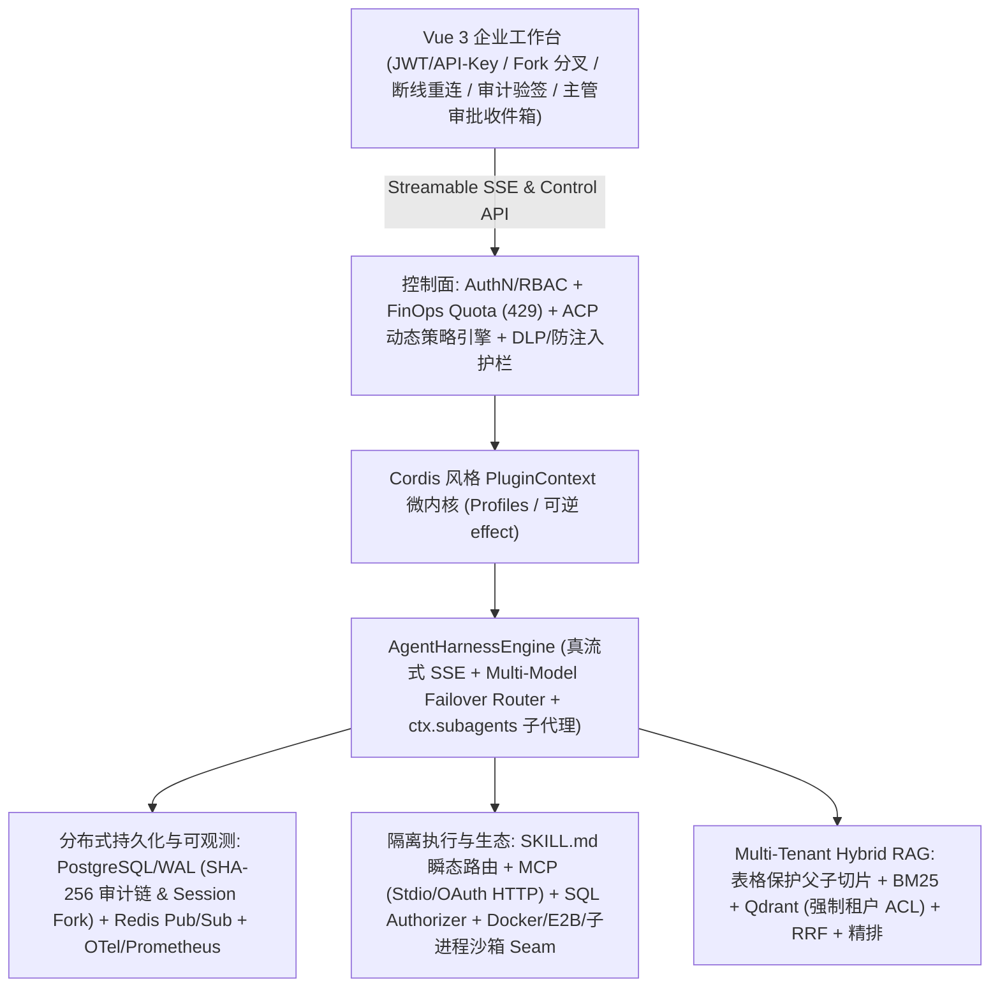

# PyHarness — Enterprise DSH-Grade Agent Harness Runtime & Hybrid RAG Platform

> **一句话定位**：深度对标 **DeepSeek Harness (DSH) + Agentic Control Plane (ACP) + Enterprise AI Hub** 架构标准，从零自研的企业内网可推行级 **AI Agent Harness 平台**（Python 3.11 + FastAPI + Vue 3 + PostgreSQL + Redis + Qdrant + Docker），专注用确定性系统工程驾驭大模型的不确定性。

[](#quick-start)
[](#architecture)
[](#architecture)
[-brightgreen.svg)](#verified-benchmarks)

---

## Why PyHarness?

市面上大量 Agent Demo 停留在“调 API + 循环执行”，在企业多部门规模化上线时会迅速暴露 **越权跨租户泄露、自提自批高危操作、死循环打爆预算、无策略拦截删库、断线丢失轨迹** 等致命痛点。PyHarness 将全套 L4 企业级运行时治理收敛在清晰透明的零黑盒模块化架构中：

* **Enterprise Security Control Plane (`pyharness/security/`, `policies/`)**：标准 HS256 JWT / Scoped API Key / 可信网关透传三模鉴权（`AuthManager`）+ `ContextVar` 全链路主体传播、**四眼原则（SoD）防自审批与审批人身份强绑定**、声明式 YAML **动态策略引擎 ACP**（支持 `DENY` / `ASK` / `ALLOW` 与影子 `AUDIT` 灰度模式、防 SQL 注释绕过）、**DLP 脱敏 + 间接 Prompt 注入隔离护栏**（落盘前脱敏保护审计日志），以及 **滑动窗口 RPM 限流 + 部门级 FinOps Token/USD 配额账本**（`/api/v1/admin/usage`）。
* **Cordis-Inspired Plugin Kernel, Subagents & Multi-Model Router (`pyharness/core/`, `runtime/`)**：基于 `PluginContext`（`provide` / `effect` LIFO 可逆卸载 / `enterprise` & `standalone` & `headless` Profiles）的可组合插件微内核；支持主备故障转移熔断与 `reasoning`/`fast` 分层路由的 **`ModelRouterLLMClient`**；具备上下文硬隔离、策略/护栏全继承与防递归防提权的 **`SubagentManager` (`ctx.subagents`)**；`stream=True` 真增量 SSE 推流与防劈裂上下文增量摘要压缩。
* **Tamper-Evident Multi-Pod Event Journal & Observability (`pyharness/runtime/journal_store.py`, `infra/`)**：支持 **PostgreSQL 16 多 Pod 事务建议锁 + SQLite WAL 异步写盘** 的存储 Seam、每会话 **SHA-256 防篡改审计哈希链（`/audit/verify`）**、基于事件溯源的 **Session Branching / Forking（`/fork`）**、Redis Pub/Sub 跨实例审批唤醒与 **`Last-Event-ID` 断线重连（`/stream`）**，以及原生 **OpenTelemetry GenAI Trace + Prometheus `/metrics`**。
* **Standard MCP (`stdio` + OAuth/Bearer HTTP) & Pluggable Safe Sandboxes (`pyharness/mcp/`, `sandbox/`, `skills/`)**：按轮次瞬态注入的 `SKILL.md` 动态路由 + `allowed_tools` 双层强管控；支持内存、**受控净空环境变量 `StdioMCPTransport` 子进程**与带 OAuth/Bearer 透传 + `Mcp-Session-Id` 的 Streamable HTTP MCP 桥；SQLite 内核 `set_authorizer` 只读沙箱（含外部只读仓库适配器 Seam）与 **`DockerSandboxProvider`（`--network=none` / gVisor `runsc`）/ `E2BSandboxProvider`（Firecracker MicroVM）/ 加固独立子进程** 三态可插拔 Python 沙箱。
* **Multi-Tenant Enterprise Hybrid RAG (`pyharness/rag/`)**：表格完整保护的 **Parent-Child 层级切片**、Query 多轮指代消解与多跳拆解、中英文 Okapi BM25 + **Qdrant 持久化向量库（UUIDv5 幂等更新、重启自动恢复、Agent 对话期强制 `tenant_id` ACL 隔离）** + RRF 融合 + Cross-Encoder 精排。
* **Full-Stack Enterprise Workbench & Eval Flywheel (`pyharness/api/`, `web/`, `eval/`)**：Vue 3 企业工作台（JWT/API-Key 鉴权栏、`Fork` 分叉、`断线重连`、`SHA-256 审计验签`、策略告警与子代理委派卡片、主管跨用户 SoD 审批收件箱）、6 服务安全加固 `docker-compose.yml` 一键部署及自动化评测套件。

---

## Architecture



---

## Verified Benchmarks（本机实测输出）

所有测试与压测均可在仓库内通过 CI 或本地一键复现：

* **全量单元、集成与企业红队测试 (`pytest -v`)**：**37 passed in 2.52s（0 Warnings）**
  * 覆盖 JWT/API-Key 鉴权与 `401`/`403`、四眼审批防自批防伪造、跨租户 Session 与对话期 RAG ACL 隔离、ACP 策略引擎硬阻断（含 SQL 注释绕过防御）与影子审计、DLP 落盘前脱敏与 Prompt 注入围栏、RPM `429` 限流与部门 FinOps 报表、Cordis 插件可逆卸载、主备模型熔断降级、`ctx.subagents` 策略继承与递归守卫、SHA-256 防篡改验签与 Session Fork、`Last-Event-ID` 断线重连、真实 `StdioMCPTransport` 子进程握手、Docker/E2B/子进程防 RCE 逃逸与 Qdrant 幂等重启恢复。
* **Agent Harness 并发工具调度与自修正实测 (`python eval/benchmark_harness.py`)**：
  | 指标 | 实测结果 | 说明 |
  | :--- | :---: | :--- |
  | 串行工具调用 P50 延迟 (`max_parallel_tools=1`) | **200.90 ms** | 3 路 60ms I/O 工具串行执行 |
  | 异步并发调用 P50 延迟 (`max_parallel_tools=4`) | **76.83 ms** | **`asyncio.gather + Semaphore`，延迟降低 61.8%** |
  | SQL Self-Correction 异常自修复验证 | **2 / 3 恢复** | 1 条不可恢复轨迹自动触发熔断并导出至 `eval/out/badcases.jsonl` |
* **Hybrid RAG 离线基准 (`python eval/benchmark_rag.py`)**：
  * 含 14 个相近工业设备型号/电压等级难负例切片，11 条多领域测试查询下 `hybrid_rerank` 实现 **100.0% Top-1/Top-3 Recall、MRR@3 = 1.0000、P50 = 1.08 ms**。

---

## Quick Start

### 方式一：本地 Python 一键启动（默认 `dev_anonymous` 零配置体验全套功能）

```bash
git clone <your-repo-url>
cd agent-harness
python -m venv .venv
# Windows PowerShell:
.\.venv\Scripts\Activate.ps1
# Linux / macOS:
# source .venv/bin/activate

pip install -e ".[dev]"

# 1. 运行全部 37 项自动化测试与 2 套压测基准
pytest -v
python eval/benchmark_rag.py
python eval/benchmark_harness.py

# 2. 启动 FastAPI 流式后端（默认免 Key 演示规划器；配置 .env 即切真实 DeepSeek/Qwen 与 enforce 鉴权）
uvicorn pyharness.api.main:app --reload --port 8000
# 健康与插件状态: http://127.0.0.1:8000/health
# Prometheus 指标: http://127.0.0.1:8000/metrics
# Swagger 文档: http://127.0.0.1:8000/docs
```

### 方式二：Docker Compose 企业级生产一键部署（API + PostgreSQL 16 + Redis + Qdrant + Docker Sandbox Proxy + Vue 3 Web）

```bash
cp .env.example .env
# 生产环境请在 .env 中配置强随机 HARNESS_JWT_SECRET 与 LLM_API_KEY
docker compose up -d --build
# 浏览器打开企业流式工作台: http://localhost:3000
```

---

## 全部 6 阶段源码精讲、面试手册与交互式实验室

* 🌟 **[交互式全栈架构图例 & 四眼审批 / SHA-256 篡改 / ACP 红队模拟器](docs/interactive_architecture_explorer.html)**（浏览器直接双击即可离线体验！）
1. [M1 — 运行时内核、SHA-256 事件溯源、多模型熔断与子代理精讲](docs/M1_runtime_mastery.md)
2. [M2 — 瞬态 SKILL.md、Stdio/OAuth MCP 与 SQL/Docker/E2B 隔离沙箱精讲](docs/M2_skills_mcp_sandbox_mastery.md)
3. [M3 — 表格保护父子切片、Qdrant 幂等持久化与对话期多租户 ACL 精讲](docs/M3_hybrid_rag_mastery.md)
4. [M4 — Redis 跨 Pod 协调、Last-Event-ID 重连、OTel/Prometheus 与 Vue 3 工作台精讲](docs/M4_fullstack_deployment_mastery.md)
5. [M5 — 自动化评测闭环与上海 Agent 面试总监级 15 题通关手册](docs/M5_eval_and_interview_playbook.md)
6. [M6 — 企业安全控制面（JWT/四眼 SoD/ACP 动态策略/DLP 防注入/FinOps）与 Cordis 插件微内核精讲](docs/M6_enterprise_security_acp_and_plugins_mastery.md)
