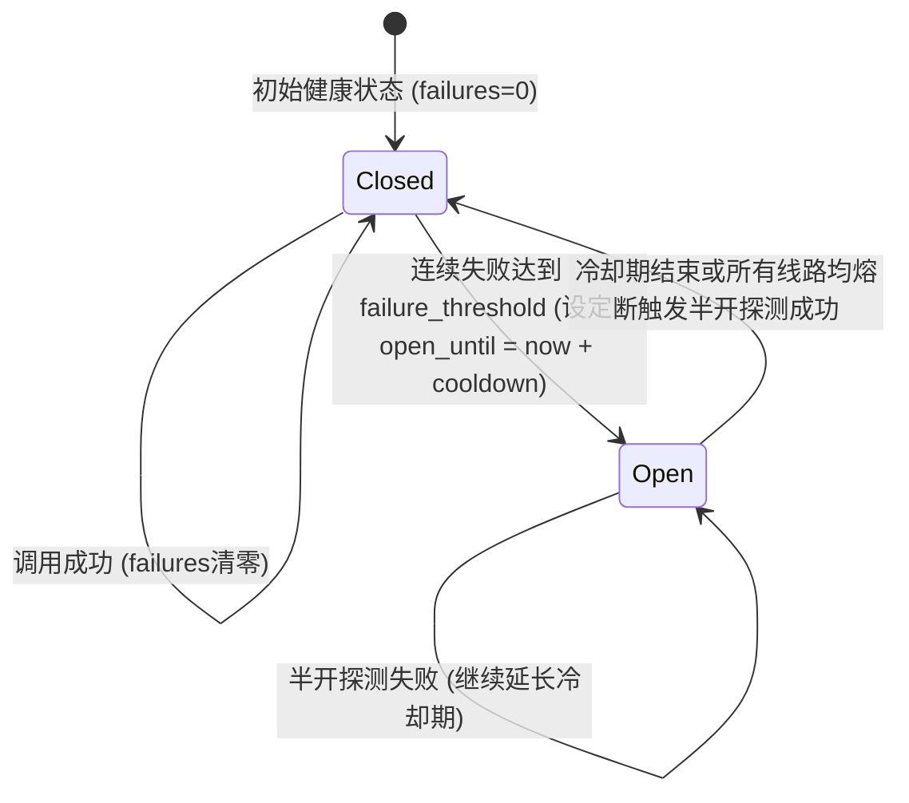

# Milestone 1（企业升级版）源码精讲：Harness 运行时内核、防篡改事件溯源、多模型熔断与子代理委派

> **对应最新源码**：
> - [schemas.py](file:///D:/Code/agent-harness/pyharness/runtime/schemas.py) | [engine.py](file:///D:/Code/agent-harness/pyharness/runtime/engine.py) | [governance.py](file:///D:/Code/agent-harness/pyharness/runtime/governance.py)
> - [event_journal.py](file:///D:/Code/agent-harness/pyharness/runtime/event_journal.py) | [journal_store.py](file:///D:/Code/agent-harness/pyharness/runtime/journal_store.py)
> - [llm_client.py](file:///D:/Code/agent-harness/pyharness/runtime/llm_client.py) | [model_router.py](file:///D:/Code/agent-harness/pyharness/runtime/model_router.py) | [subagents.py](file:///D:/Code/agent-harness/pyharness/runtime/subagents.py)
> - **交互式实验**：打开 [interactive_architecture_explorer.html](file:///D:/Code/agent-harness/docs/interactive_architecture_explorer.html) 体验 Tab 2（全链路模拟）与 Tab 3（SHA-256 防篡改验签 + Session Fork）！

---

## 一、 核心设计哲学：什么是 L4 级 Agent Harness Engineering？

在生产环境里，大语言模型本质是一个**高波动概率引擎**（可能输出坏 JSON、陷入失败工具死循环、在无权限时调用高危操作、遇到厂商 API 503 限流）。**Agent Harness（运行时缰绳）**的核心使命是：**用 100% 确定性的软件工程系统把概率模型关进安全、可控、可中断、可审计的牢笼中运行**。

升级后的 Runtime 内核包含 6 大支柱：
1. **可插拔持久化事件溯源 + SHA-256 防篡改审计链**（`EventJournal` + `JournalStorageBackend`）
2. **协作式取消 + 四眼原则审批 + 防劈裂增量上下文压缩**（`governance.py`）
3. **真增量流式推流 + 信号量并发工具 + Self-Correction 熔断**（`engine.py`）
4. **分层多模型路由与半开探测熔断降级**（`ModelRouterLLMClient`）
5. **上下文硬隔离 + 零提权递归守卫子代理**（`SubagentManager`）
6. **可逆生命周期插件钩子**（`HarnessHook`）

---

## 二、 逐模块源码深度拆解

### 模块 1：防篡改事件溯源与会话分叉（`event_journal.py` & `journal_store.py`）

#### 1. 为什么把存储层抽象出 `JournalStorageBackend` Seam？
早期版本把 SQLite 硬编码在 `EventJournal` 里，多实例 K8s 部署时多个 Pod 各自写本地文件会直接分裂！新版抽离出 `JournalStorageBackend` 接口，提供两套零改动切换的后端：
* **`SQLiteJournalStore`（本地 / 单机）**：启用 WAL（Write-Ahead Logging）模式支持并发读，内部线程锁保护单调 `seq`。
* **`PostgresJournalStore`（企业多 Pod 生产集群）**：在写入事件前执行事务级建议锁（`pg_advisory_xact_lock(hashtext(session_id))`），确保即使 10 个 FastAPI Pod 同时往同一个 `session_id` 写事件，序号 `seq` 和哈希链也绝对严格递增、永不冲突！

#### 2. SHA-256 防篡改审计哈希链（`compute_event_hash` & `verify_chain`）
看 `journal_store.py` 第 52–70 行：每条事件落盘时，不仅保存自身载荷，还把**上一条事件的哈希 `prev_hash`**（首条为 64 个 `'0'` 的 `GENESIS_HASH`）与当前全部关键字段拼接做 SHA-256：

```text
event_hash(seq) = SHA256(
    prev_hash | session_id | seq | event_type | timestamp_ms | tenant_id | user_id | canonical_payload_json
)
```

* **怎么防内部运维篡改日志？** 假设有人直接登录数据库，偷偷把第 3 条事件里的 `"approved": false` 改成 `"approved": true`。当审计员调用 `GET /api/v1/sessions/{id}/audit/verify` 时，`_verify_rows()` 从 `GENESIS_HASH` 开始逐条重算哈希：
  1. `seq=3` 重算出的 `recomputed != stored_event_hash` $\rightarrow$ 立刻报 `valid=False, broken_at_seq=3`！
  2. 即使黑客顺手重算了第 3 条的 `event_hash`，第 4 条的 `prev_hash` 也会立刻断链暴露！
  3. 同时检查 `seq == expected_seq`（防偷偷 `DELETE` 删掉某条中间日志！）。

#### 3. 基于事件溯源的 Session Forking（会话时间点分叉 `/fork`）
因为所有历史状态均由有序事件流决定，系统支持在任意历史检查点 `at_seq` 克隆出一条全新子会话（`parent_session_id` + `forked_from_seq`），重新计算新会话独立的 SHA-256 链并追加 `session_forked` 事件。
* **业务价值**：用户在第 5 步发现推理走偏，不用从头重聊，直接在第 3 步 **Fork 分叉** 换一种提问或参数做平行对比实验（类似 Git Branch）！

---

### 模块 2：多模型分层路由与熔断器（`pyharness/runtime/model_router.py`）

企业在生产中绝不能只绑死 1 个模型厂商（DeepSeek 高峰期可能 503/429，且用贵价推理模型去做简单 Query 改写极度烧钱！）。

#### 1. 分层路由（Tiered Routing）+ 透明代理 `_TierScopedLLMProxy`
* 为不同任务配置不同 `tier`：
  * `tier="reasoning"`：主规划、复杂多跳决策（例如 DeepSeek-R1 / Qwen-Max，按 `priority=0, 1` 排主备）；
  * `tier="fast"`：上下文摘要压缩、Query 改写、只读子代理（例如 Qwen-Turbo / DeepSeek-Chat，低延迟低成本）。
* `router.for_tier("fast")` 返回一个符合 `BaseLLMClient` 接口的轻量代理，直接注入 `ContextCompressor`、`QueryRewriter` 和 `SubagentManager`，下游模块完全无感知！

#### 2. 熔断器状态机（Closed $\rightarrow$ Open $\rightarrow$ Half-Open Probe）

* **极其精致的流式防撕裂细节（看 `model_router.py` 第 166–170 行！）**：
  * 如果主模型在**吐出第 1 个 Token 之前**就报 503/超时（`yielded_any == False`）$\rightarrow$ **无感秒切备用模型**，用户完全察觉不到故障！
  * 如果主模型已经向前端吐了一半汉字（`yielded_any == True`）才断连 $\rightarrow$ **绝对不能静默切备模型接着拼接胡言乱语**，必须显式抛异常交由上层处理！

---

### 模块 3：上下文硬隔离与防提权子代理（`pyharness/runtime/subagents.py`）

灵感源自 DSH `ctx.subagents`，解决“单 Agent 上下文被几十条检索和 SQL 中间输出塞爆”的难题：

#### 1. 两个内置专家 Profile（`DEFAULT_SUBAGENT_PROFILES`）
* **`researcher`**：只读企业知识与工单调查专家（工具白名单仅 `rag_search`, `mcp_list_incidents`，`model_tier="fast"`，`allow_high_risk=False`）。
* **`analyst`**：结构化 SQL 与 Python 统计计算专家（工具白名单仅 `inspect_sql_schema`, `query_sql_readonly`, `run_python_sandbox`）。
* 主协调者通过调用 `delegate_subagent` 委派子任务，子代理在**独立的子会话上下文**中完成多步探索，最后**只把精炼后的结构化摘要 JSON 返回给主代理**，主代理上下文瞬间瘦身 80%！支持 `one_shot`（一次性子任务）与 `continuable`（可续聊多轮子会话）。

#### 2. 四道防递归与防越权铁锁（面试红队攻防必讲！看 `subagents.py` 第 217–258 行）
1. **递归深度硬封顶**：通过 `ContextVar` 追踪 `_subagent_depth`，达到 `max_depth=2` 直接拒绝委派并从工具列表中剥离 `delegate_subagent`，杜绝“子调孙、孙调曾孙”无限套娃！
2. **高危工具默认剥离**：除非 Profile 显式设置 `allow_high_risk=True`，否则子代理一律过滤掉所有 `RiskLevel.HIGH` 工具（防止通过委派绕过高危风控）。
3. **父子权限交集（Intersection）**：如果父会话本身只允许部分工具，子代理有效工具集必须与父级取**交集**，严禁“低权限父代理借高权限子代理提权”！
4. **治理与取消全继承**：通过 `bind_parent_context()` 经由 `ContextVar` 自动继承父级的 `Principal`（租户/角色）、`PolicyEngine`（ACP 策略）、`GuardrailHook`（DLP 脱敏）、`TelemetryRecorder` 以及 **`CancellationToken`**（父会话一点停止，所有运行中的子代理毫秒级联取消！）。

---

### 模块 4：核心执行引擎与治理升级（`engine.py` & `governance.py`）

1. **真增量流式输出（`stream=True`）**：升级后的 `llm_client.py` 与 `engine.py` 原生支持从 OpenAI-Compatible SSE 流逐片解析 `delta.content`、`delta.reasoning_content` 以及分片拼接 `delta.tool_calls` JSON 参数，首字延迟（TTFT）从数秒降至几百毫秒！
2. **防劈裂上下文增量压缩（`ContextCompressor`）**：
   * 截断历史前循环检查 `while split_at > 0 and body[split_at].role == "tool": split_at -= 1`，**保证绝不把 `assistant(tool_calls)` 折叠进摘要而留下孤立的 `tool` 消息**（否则下游 LLM API 必报 400！）。
   * 既支持确定性零成本规则折叠，也支持挂载 `fast` 档轻量 LLM 生成语义摘要。
3. **四眼原则（Separation of Duties, SoD）防自审批**：
   * 在新版 `ApprovalBroker` 中，待审批请求强制绑定 `requester_id` 与 `tenant_id`。
   * 审批时后端从加密鉴权后的 `Principal` 提取真实审批人（**绝不信任前端 JSON 传入的 `reviewer` 字符串！**）：① 同一个人自提自批 $\rightarrow$ `403`；② 跨租户审批 $\rightarrow$ `403`；③ 缺少策略要求角色（如 `approver`/`admin`）$\rightarrow$ `403`！

---

## 三、 本阶段上海一面高频深挖 8 题

1. **Q：为什么用 `ContextVar` 传递 `Principal`、子代理深度和取消令牌，而不用全局变量或给每个函数加 10 个参数？**
   * *答*：Python `asyncio` 是单线程协程并发，全局变量会在不同用户请求之间互相串味造成严重越权事故；`ContextVar` 天生按协程任务隔离并自动随 `asyncio.create_task` 向下继承，既保证了高并发多租户零串数据，又让工具函数签名保持极其干净。
2. **Q：PostgreSQL 存储 Event Journal 时，两个 Pod 同时向同一个 `session_id` 写事件导致 `seq` 冲突怎么解决？**
   * *答*：使用事务级建议锁 `pg_advisory_xact_lock(hashtext(session_id))` 按会话粒度串行化写入——不同会话之间 100% 并发无锁竞争，同一会话内部严格保证 `seq` 单调递增和 SHA-256 `prev_hash` 不断链。
3. **Q：主模型流式输出一半突然网络断开，ModelRouter 能不能自动切换备用模型续写？**
   * *答*：不能！`model_router.py` 用 `yielded_any` 标志位精确区分：首字未出前静默故障转移；已吐出部分 Token 后直接上抛错误，防止两个模型拼接出语义错乱或数字自相矛盾的脏内容。
4. **Q：子代理委派（Subagent）最容易出现哪两种安全漏洞？你的代码怎么防的？**
   * *答*：① **无限递归烧钱** $\rightarrow$ `ContextVar` 追踪深度 + 达上限剥离 `delegate_subagent`；② **权限逃逸提权** $\rightarrow$ 子代理强制继承父级 `Principal` / `PolicyEngine` / `GuardrailHook`、有效工具集取父子交集、默认剥离一切 `HIGH` 风险工具。
5. **Q：为什么 Event Journal 要做 SHA-256 哈希链？直接存数据库日志不够吗？**
   * *答*：金融/能源/大型零售等强合规企业要求日志**不可抵赖、防内部篡改**。哈希链把每条事件的 `tenant_id`、`user_id`、`payload` 与前序哈希绑定，任何事后改库或删行都会在 `/audit/verify` 验签时精确暴露到具体的 `broken_at_seq`。
6. **Q：上下文压缩为什么必须防劈裂 `tool_call` 和 `tool` 消息对？**
   * *答*：OpenAI/DeepSeek/Qwen 协议强制校验每条 `role="tool"` 的 `tool_call_id` 必须紧跟前序 `assistant.tool_calls`，硬切会导致整个会话后续永久报 `400 Bad Request` 瘫痪。
7. **Q：如何防止用户伪造 JSON 中的 `reviewer: "admin"` 绕过四眼审批？**
   * *答*：审批接口强制走 `AuthManager` 验签拿到可信 `Principal`，完全忽略请求体中不可信的 `reviewer` 字段，用密码学验证过的 `principal.user_id` 校验 `requester_id != principal.user_id` 且同租户且具 `approver/admin` 角色。
8. **Q：并发工具调用时怎么防止把下游数据库打挂？**
   * *答*：`asyncio.gather` 外套 `asyncio.Semaphore(max_parallel_tools)` 限流，同步阻塞函数通过 `inspect.iscoroutinefunction` 自动分流至 `asyncio.to_thread` 避免卡死事件循环。
